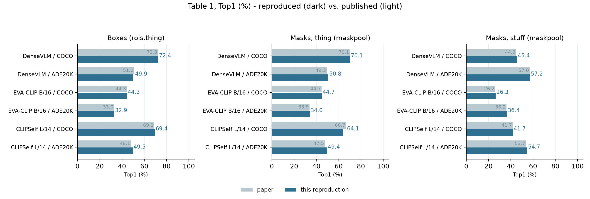
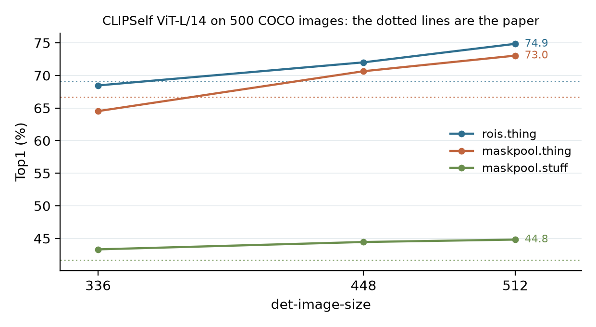

<p align="center">
  <h1 align="center">DenseVLM Reproduction &mdash; ICCV 2025</h1>
  <p align="center">
    An independent reproduction of <em>Unbiased Region-Language Alignment for Open-Vocabulary Dense Prediction</em>,
    run end-to-end on a single 8 GB consumer GPU.
  </p>
</p>

<p align="center">
  <a href="https://arxiv.org/abs/2412.06244"></a>
  <a href="https://github.com/HVision-NKU/DenseVLM"></a>
  
  
</p>

<p align="center">
  
</p>

This repository is **not** a fork of the authors' code. It holds the harness, the
measurements and the reasoning needed to check the paper's Table 1 on ordinary hardware;
the upstream repository is cloned as a subdirectory and left byte-for-byte untouched
(`HEAD 8ca50f7`, clean working tree for the whole reproduction).

> **中文摘要**：在单张 RTX 5060 Laptop（8 GB）的 WSL2 环境里复现了 DenseVLM (ICCV 2025) 表 1
> 的全部六行区域分类结果，其中四行落在 0.25 点内；表 2–8 需要约 27 次 4×A40 全量训练以及
> A-847 / PC-459 / LVIS 数据与 SAN / CAT-Seg / F-ViT 代码，本机不可行，理由与算式都写在
> [`docs/REPRO_STATUS.md`](docs/REPRO_STATUS.md)。三条关键发现见下方 Findings。

## Contributions

- 🔥 **Table 1 reproduced for every setting whose weights are public**: DenseVLM itself, the
  EVA-CLIP ViT-B/16 baseline, and the CLIPSelf ViT-L/14 baseline, on both COCO val2017
  (5000 images) and ADE20K val (2000 images).
- 🔥 **The baseline rows are the actual evidence.** They run through the same code path as
  DenseVLM and land within 0.25 points of the paper, which validates the evaluation protocol
  rather than just the headline numbers.
- 🔥 **Three concrete traps documented with numbers**: torchvision's mask-resize change (worth
  ~9 points), the unstated input resolution of the CLIPSelf row (worth 3–8 points), and the
  attention-backend equivalence (0.0000 difference on all 12 metrics).
- 🔥 **A one-command driver and a log-driven result collector**, so every number in `results/`
  can be regenerated from raw logs instead of retyped.

## Results

Top1 / Top5. A run counts as reproduced when it lands within 0.5 points of the paper.

| Setting | Dataset | Boxes | Masks (thing) | Masks (stuff) | Δ Top1 vs paper |
|---|---|---|---|---|---|
| **DenseVLM** | COCO val2017 | 72.42 / 89.79 | 70.12 / 84.48 | 45.42 / 77.75 | +0.12 / +0.02 / +0.52 |
| **DenseVLM** | ADE20K val | 49.86 / 81.01 | 50.76 / 77.22 | 57.17 / 84.88 | −1.14 / +1.46 / +0.17 |
| EVA-CLIP ViT-B/16 | COCO val2017 | 44.26 / 68.67 | 44.73 / 66.81 | 26.27 / 51.87 | −0.04 / +0.03 / +0.07 |
| EVA-CLIP ViT-B/16 | ADE20K val | 32.89 / 57.68 | 33.96 / 56.17 | 36.44 / 62.49 | −0.11 / +0.06 / +0.24 |
| CLIPSelf ViT-L/14 @336 | COCO val2017 | 69.37 / 87.53 | 64.07 / 78.02 | 41.72 / 73.29 | +0.27 / −2.63 / +0.02 |
| CLIPSelf ViT-L/14 @336 | ADE20K val | 49.55 / 80.83 | 49.42 / 74.03 | 54.69 / 81.11 | +1.45 / +1.92 / +0.99 |

Peak memory peaks at 1.45 GB (B/16, COCO) and 5.56 GB (L/14, ADE20K); full wall-clock timings
and per-run logs are in [`results/metrics.md`](results/metrics.md).

## Findings

### 1. torchvision's mask resize is worth nine points

Newer `Resize` antialias behaviour drops COCO `maskpool.stuff` from **45.4 to 35.9**.
The `--legacy-mask-resize` shim in `scripts/linux/run_densevlm_linux.py` restores torchvision
0.15 semantics. Without it the paper is not reproducible on that column, and the failure looks
like a modelling problem rather than a preprocessing one.

### 2. The CLIPSelf row is evaluated at its native 336, not at 512

The paper says inputs are resized to 512×512 but never states per-baseline resolution. On a
fixed 500-image subset, `rois.thing` climbs monotonically with input size:

<p align="center">
  
</p>

Only 336 matches the published 69.1; running at 512 inflates the score by 3–8 points. This row
also needs `--downsample-factor 14` (the L/14 feature map is 1296, not 1024) and a 768-dimensional
text embedding — the release only ships the 512-dimensional B/16 file. See
[`docs/LINUX_WSL.md`](docs/LINUX_WSL.md) for the generator and its validation
(row-wise cosine 1.000000 against the shipped B/16 file).

### 3. The attention backend does not matter

Native xFormers and SDPA agree to the last digit on all 12 COCO metrics, same machine, same
weights. SDPA is 28.9% slower at identical memory. The residual 0.03-point gap between the
Windows and Linux runs is platform, not backend.

## TODO

- [x] Reproduce Table 1 for all settings with public weights
- [x] Align the training pipeline (FP16/BF16 smoke, per-batch KL, update semantics, checkpoint reload)
- [x] Prove backend equivalence on-device (xFormers vs SDPA)
- [x] Determine what Tables 2–8 would actually require
- [ ] Re-run the ablations on a 24 GB+ GPU (batch 4–8, ~27 runs)
- [ ] Open-vocabulary segmentation/detection rows (needs A-847, PC-459, COCO-Stuff, LVIS + SAN, CAT-Seg, F-ViT)

## Quick Start

### 1. Environment

Takes a WSL2 Ubuntu 26.04 machine with an RTX 5060 (sm_120). The single most important
constraint: **torch and xFormers must agree on the CUDA major version** — a cu128 build with
the cu130 xFormers fails with `ImportError: libcudart.so.13`.

```bash
uv venv ~/.venvs/densevlm --python 3.11
uv pip install --index-url https://mirrors.aliyun.com/pypi/simple \
    --find-links https://mirrors.aliyun.com/pytorch-wheels/cu130 \
    -r requirements-linux.txt
python scripts/linux/check_gpu_linux.py     # RoIAlign + attention sanity check on sm_120
```

### 2. Upstream code, weights and data

```bash
git clone https://github.com/HVision-NKU/DenseVLM.git
# then follow docs/LINUX_WSL.md: COCO val2017, ADE20K panoptic val,
# metadata embeddings, and the DenseVLM checkpoint (SHA-256 in the table below)
```

### 3. Evaluate

```bash
scripts/ctl.sh health                                        # machine + weights + data
scripts/ctl.sh eval full        densevlm_coco_val2017_linux_xf   # COCO 5000,  ~14 min
scripts/ctl.sh eval ade         densevlm_ade20k_val_linux_xf     # ADE20K 2000, ~8 min
scripts/ctl.sh eval eva_coco    eva_clip_b16_coco_val2017        # baseline
scripts/ctl.sh eval clipself_coco clipself_l14_336_coco_val2017  # baseline, 336 + ds14
scripts/ctl.sh train amp        densevlm_train4_linux_amp        # training smoke, 4 images
```

`scripts/ctl.sh` runs the job on the remote host with `nohup`, polls until metrics appear, and
prints them. `scripts/ctl.sh runs | log <name> | metrics <name>` inspects finished runs.

### 4. Regenerate the tables and figures

```bash
python3 scripts/linux/collect_results.py    # work/*.log -> results/{metrics.csv,metrics.md}
python3 scripts/linux/make_figures.py       # results/metrics.csv -> assets/*.png
```

## Model zoo

Only weights that the authors publish are used; SHA-256 recorded so a rerun can be verified.

| Checkpoint | Size (B) | SHA-256 | Used for |
|---|---|---|---|
| `densevlm_coco_6_save6_512_eva_vib16_12layers.pt` | 1,270,791,043 | `16bb52aece2598a62dffe3707930a3c58dee0a20360b9aebb7923a7543156769` | DenseVLM rows |
| `clipself_coco_6_save6_512_eva_vitl14_24layers.pt` | 1,719,960,718 | `a4f17b67ee9f463a714d296b2b95a8a8aa468dbc004019f48a35db9844559a82` | CLIPSelf rows |
| `EVA02_CLIP_B_psz16_s8B.pt` | 299,522,626 | `4aab21dd652dc19aab7ff2302e5a07582d7838e8a3b26c80d697115fb0c6ddf0` | EVA-CLIP baseline, training teacher |

## What is not reproduced, and why

| Paper table | Blocker |
|---|---|
| T2–T6 (framework / alignment / class-set / P-VLM / backbone) | ~27 full runs, each 6 epochs over 118k images. The paper reports 4×A40 at 37–39 GB per device, 23–55 min/epoch; at 8 GB with batch 2–4 that is 1–4 days per run, 1–3 months in total. |
| T7 (open-vocabulary segmentation) | Needs A-847, PC-459 and COCO-Stuff data plus SAN and CAT-Seg code, none released. |
| T8 (open-vocabulary detection) | Needs LVIS and F-ViT. |
| T1, OpenCLIP / SigLIP / DFN rows | Weights sit behind HF Xet storage; the redirect to `cas-bridge.xethub.hf.co` fails DNS from this network. |

The arithmetic and the alternatives are written up in
[`docs/REPRO_STATUS.md`](docs/REPRO_STATUS.md) and [`docs/guide/roadmap.md`](docs/guide/roadmap.md).

## Repository layout

```
docs/REPRO_STATUS.md        authoritative reproduction log: numbers, peaks, timings, SHA-256, reasoning
docs/LINUX_WSL.md           environment build, mirrors, cu130 pinning, text-embedding generation
docs/RESEARCH_CONTEXT.md    what the project is for and what was asked of it
docs/VSCODE.md              remote editing setup (Remote-SSH over Tailscale, Remote-WSL)
docs/REMOTE_TUNNELS.md      why the VS Code tunnel alone was not enough
docs/guide/                 roadmap (phase 0-7), decision log, cheatsheet, experiment template,
                            one-page conclusion
scripts/ctl.sh              single entry point: health / eval / train / metrics / runs / log
scripts/linux/              Linux entry point, GPU check, embedding generator, result collector,
                            figure generator, ADE20K probes
scripts/windows/            Windows entry point and the WSL keep-alive scheduled task
results/                    generated metric tables (never hand-edited)
assets/                     generated figures
```

## Citation

If this reproduction is useful, please cite the original paper:

```bibtex
@inproceedings{li2025densevlm,
  title     = {Unbiased Region-Language Alignment for Open-Vocabulary Dense Prediction},
  author    = {Li, Yunheng and Li, Yuxuan and Zeng, Quansheng and Wang, Wenhai and Hou, Qibin and Cheng, Ming-Ming},
  booktitle = {Proceedings of the IEEE/CVF International Conference on Computer Vision (ICCV)},
  year      = {2025}
}
```

## Acknowledgements

The upstream code, weights and data are the work of the DenseVLM authors (Nankai University
and collaborators). This repository contributes only the Linux harness, the measurements and
the documentation. EVA-CLIP, CLIPSelf and Mask2Former components are used as published.

## Licence

No licence has been chosen yet, so treat this repository as all rights reserved. Upstream
code, weights and datasets are not redistributed here and remain under their own terms.
